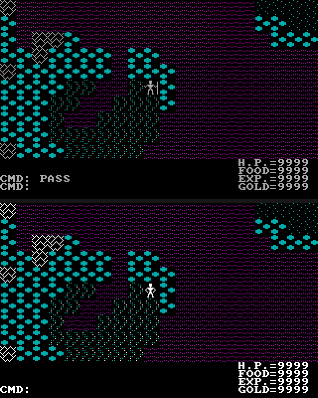
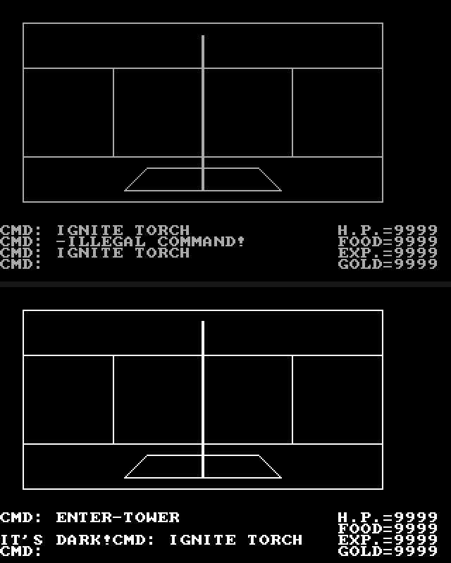

# Ultima II — a faithful reproduction in portable C

[](https://github.com/sloppy-seconds/ultima2-decompile/actions/workflows/asm-checksum.yml)
[](https://github.com/sloppy-seconds/ultima2-decompile/actions/workflows/engine-tests.yml)
[](https://github.com/sloppy-seconds/ultima2-decompile/actions/workflows/gate-suite.yml)

**Ultima II: Revenge of the Enchantress** (Richard Garriott / Origin Systems,
1982/83), reimplemented as a native C11 program that plays the game without DOS
emulation.

The goal is the working game. The decompilation is how we got the details right.

That ordering is a correction we made on the way. The plan was to reconstruct the
original as readable, byte-proven x86 real-mode assembly and treat that as the
deliverable. We built it — `asm/` re-assembles to a byte-for-byte identical copy
of the executable, verified per function and for the whole binary, in CI, on
every push — and then had to admit what it was: a perfect copy of a 1983
hand-written assembler listing, still requiring a DOS emulator, still the same
program the player already had. Proving you understood the binary is not the same
as shipping something useful. So the reconstruction stayed, but it became the
**means**: the reference that makes the C engine's behaviour defensible when a
question is subtle enough that playing the game will not tell you the answer.

## What it looks like

Each image is the **original on top and our engine below**, captured from the same
seeded save at the same position, so the pair is a comparison and not two
unrelated moments.

Overworld — sector 20, the same tile layout, status block and message log:



Tower interior — the first-person wireframe, entered at the same cell and lit with
a torch. The nested rectangles, the rope and the hole it hangs out of are drawn
from the original's own geometry tables:



## Two methods, both load-bearing

**Reading the bytes.** The asm tree is the authority on what the program does, and
every claim in the engine cites the file that proves it.

**Watching it run.** The original boots under [Spice86](https://github.com/Spice86/spice86),
an x86 emulator and debugger, and we drive it two ways: scripted captures that
dump executed-instruction traces, memory and screenshots without a human, and
**live human play**, where the owner plays and describes what happens.

The second method mattered more than expected. A number of behaviours were written
down confidently from the bytes and were **wrong** — the food cost per step, the
shape of the command loop, what a tower ladder does versus a dungeon ladder, the
colour of a dungeon creature. A running emulator refuted each of them. Several
were only visible on screen at all: the dungeon creature is a cyan body with a
magenta mouth because the sprite pattern field selects a CGA colour, and nothing
in the static disassembly says so without also reading a self-modified table out
of live memory.

So every claim in this repo carries a grade — `observed` (a byte or a live value),
`measured` (derived by a named tool), `inferred` (reasoned from a partial read),
`recalled` (the owner's memory of playing it) — and the grade is stated wherever it
matters. `docs/needs-gameplay.md` is the standing list of questions that only
playing can settle, with a note on who can settle each one.

## Status: in progress

There is a **working game**. CP0 through CP7 are green, and `tools/check_all.sh`
is green. That covers the title flow, character creation, the status screen,
saves (including loading a save the original wrote and vice versa), the overworld
with passability, sector wrap and the food/time model, towns, commerce and NPC
dialogue, and the dungeon engine: entering, torches and darkness, the wireframe,
walking, combat, looting, traps, spawning and descending.

**Not all gameplay is proven.** Some behaviours are implemented from static
reading and have never been seen executing in a capture; those carry an explicit
`UNPROVEN` marker in the source, and the project does not get to call itself
code-complete while one stands. `python3 tools/cmd_handlers.py` prints which
command handlers have execution evidence and which do not, and it is a gate, not
a list. Open questions are in `docs/needs-gameplay.md`.

What is deliberately **not** claimed: the C engine is a reimplementation. It is
not byte-proven and never will be. The proof lives in `asm/`; the engine's
contract is behaviour.

## Target & provenance — read this

* The analyzed binary is the **Ultima II distribution available on the
  Internet Archive** — the DOS software-library item is
  [archive.org/details/msdos_Ultima_II_-_Revenge_of_the_Enchantress_1983](https://archive.org/details/msdos_Ultima_II_-_Revenge_of_the_Enchantress_1983)
  — not a factory-shipped copy. The pack **appears to already include community
  patches**, so "byte-exact" here means byte-exact to *this* image:
  `ultimaii.exe`, 37,344 bytes, md5 `fe884d5117971073ac8097cc7a6aca25`.
* **This repository contains no game data.** The sector maps, monster and dialogue
  files, pictures and saves are copyrighted and are not distributed here
  (`.gitignore` enforces it as policy, and the git history is clean of them). The
  game's *text* is published, in one generated file, for the reasons in AGENTS.md
  § 0. To reproduce or play, supply your own legally obtained copy of the data.
* The reconstructed assembly is a derivative work of the copyrighted binary in
  symbolic form, published for **research, education and interoperability** in the
  tradition of other classic-game decompilation projects. If you represent the
  rights holder and want something changed or removed, open an issue — it will be
  acted on promptly.

### Text is committed; art is substituted

Text is load-bearing for fidelity and cannot be substituted — if the engine prints
anything other than `NO DOOR THERE!` it is simply wrong. So the game's strings are
in this repository, in one generated file, `engine/content/gen_content.h`. It is
produced by `engine/tools/extract/extractor.py` and never hand-edited, and
`make -C engine content-check` proves it still agrees with the byte-proven `asm/`
tree, which carries the same text as part of the reconstruction. The reasoning,
including why text and art get different treatment, is in AGENTS.md § 0.

**Art and sound are different**: they can be redrawn, so they are. The engine ships
original substitute tile art under `engine/assets/tiles/cleanroom/`, made to a
written specification by someone who was not allowed to look at the originals, and
`PROVENANCE.md` beside it is the legal record. The procedure, the verification
chain and the times it failed are documented in `docs/cleanroom-procedure.md`. The
gate that checks substitute art against the originals is run *against* finished
art and is never handed to whoever draws it.

**The world data is neither.** `mapxNN` sector maps, `monxNN` monster data,
`tlkxNN` NPC dialogue, the `pic*` pictures and the `player` save are the game, not
the engine, and they stay on your disk. Ultima II is not a single-file game: the
37 KB executable is the engine and the pack used here is 94 files totalling about
2.2 MB.

## Playing it

### The player binary — nothing to build, no DOS

One file, statically linked, plus your own copy of the game.

**1. Get the game files.** Use a copy you already own, or the distribution this
project was built against: [archive.org/details/msdos_Ultima_II_-_Revenge_of_the_Enchantress_1983](https://archive.org/details/msdos_Ultima_II_-_Revenge_of_the_Enchantress_1983).
Download `Ultima_II_-_Revenge_of_the_Enchantress_1983.zip` and unzip it to a
folder of its own, say `~/u2`. That folder must be **writable**: the original
rewrote its own sector files, and so does the engine.

```bash
mkdir -p ~/u2 && cd ~/u2
unzip ~/Downloads/Ultima_II_-_Revenge_of_the_Enchantress_1983.zip
ls | head        # ultimaii.exe, mapxNN, monxNN, tlkxNN, picdng..pictwn, player
```

If the archive unpacks into a directory of its own, point `--data-dir` at the
folder that actually holds `ultimaii.exe`. The pack also ships an `updated/`
directory of community patches; this project's ground truth is the patched
`ultimaii.exe` described under Target & provenance below, and the engine reads
whatever executable you put in the data directory.

**2. Get the binary.** Player binaries are attached to each [GitHub
Release](https://github.com/sloppy-seconds/ultima2-decompile/releases) by
`.github/workflows/release-builds.yml` — `u2-sdl-static` for Linux and
`u2-sdl.exe` for Windows, with `SHA256SUMS.txt`. They are built on runners from
this repository alone, so if you can read this you can download them. To build
one locally instead, `deploy/linuxbuild/build.sh` and `deploy/winbuild/build.sh`
produce exactly what CI does, inside a container, and leave your host alone.

**3. Put the binary in that folder and run it.**

```bash
sha256sum -c SHA256SUMS.txt            # if you downloaded a release
mv u2-sdl-static ~/u2/ && cd ~/u2 && chmod +x u2-sdl-static
./u2-sdl-static
```

No flags. The data directory defaults to `.`, the same default drive the original
used, and an SDL build opens the window by default. `ultimaii.exe` in the folder
is where the tile art is extracted from on first run and cached afterwards (in
`./saves/tiles.u2tl`, beside your save). If you would rather keep the binary
somewhere else, say so once: `--data-dir ~/u2`.

If the world is not there the engine says which part is missing — *no executable
and no cached tiles: point --data-dir at your Ultima II directory* — rather than
opening an empty map. Add `--cleanroom` to draw the substitute art instead of the
original's, and it will always announce that it is doing so. `--renderer=terminal`
runs the text front end in the same binary, if you want that for some reason.

Both binaries have been played. The Linux one is what the owner and the tests run
 day to day. The Windows one was run **under wine** (on Bazzite Linux, 2026-11-02):
it starts, creates a character, plays the overworld, enters towns and fights, and
it loads a save the Linux build wrote. Wine is not Windows — it implements the
Win32 API, not the drivers under it — so a real GPU, a real sound device and real
Windows filesystem behaviour are still untested. If you have actual Windows and it
misbehaves, that report is worth more to this project than anything the CI can do.

**4. Saves: there is no disk to manage.** The original ran from floppies and asked
you to insert them; the engine keeps one file. Your character lives at
`--save-dir DIR/PLAYER`, default `./saves`, created automatically if absent. It is
the same 256-byte record format the original used, so a save the original wrote
loads here and a save the engine wrote loads there — `tools/save_cross_load.py`
proves both directions against the live game. Keep `--save-dir` somewhere writable
even if you mount the game folder read-only.

### Building the engine from source

**Requirements:** a C11 compiler and `python3`. The terminal build has **no
third-party libraries at all**. `make sdl` additionally needs SDL2 (on
Fedora/Bazzite the `sdl2-compat` package provides `sdl2-config`).

```bash
cd engine
make                      # cc only, C11, no third-party dependencies
make test                 # CP0..CP7 acceptance checks
./u2 --data-dir ~/u2      # interactive terminal play

make sdl && ./u2-sdl --data-dir ~/u2    # SDL2 bitmap front end (the default
                                        # renderer in that binary is the window)
```

Two notes that save confusion:

* The strings are already in the repo (`engine/content/gen_content.h`), so a
  checkout builds a complete game with no copy of the binary present. If you do
  have one at `../original/ultimaii.exe`, `make content` refreshes that file from
  it; `make content-check` verifies the committed copy against `asm/` without it.
* `build/`, the binaries and the tile cache are gitignored. `content/` is the one
  generated directory that is tracked, and it is the one thing a build must never
  regenerate by itself.

The headless and scripted modes (`--headless`, `--script`, `--dump-state`,
`--dump-each`, `--trace`, `--seed`, `--replay-report`) are the contract the tests
drive the engine through; see `engine/README.md`. They are also how the automated
differential captures against the original work.

### The reconstruction under DOSBox

This is the proof that the asm is byte-exact, and otherwise the same game.

```bash
# 1. Extract your own copy of Ultima II into a game folder (see the item linked
#    under Target & provenance), so it holds ultimaii.exe / ULTIMA2.EXE.
# 2. Build the reconstruction (no original needed):
bash tools/assemble_clean.sh build/ULTIMA2.EXE
#    -> "CLEAN REBUILD CHECKSUM-MATCH ... md5 OK"
# 3. Drop it into the game folder and run it in a DOS emulator.
cp build/ULTIMA2.EXE ~/u2/
dosbox -c 'mount c ~/u2' -c 'c:' -c 'ULTIMA2.EXE'
```

Ultima II is **not** a single-file game. The 37 KB executable is the engine; the
content lives in sidecar files in the same folder — `mapxNN` sector maps, `monxNN`
monster data, `tlkxNN` NPC dialogue, the `pic*` picture files, and the `player`
save. The pack used here holds 94 files totalling about 2.2 MB, and the game reads
and rewrites them in place. If the reconstructed binary cannot find its data it is
not broken — you are in a directory without the sidecars.

## Verifying the reconstruction

Requirements: GNU `as`/`objcopy` (binutils) and `python3`. Nothing to install.

```bash
# full rebuild from the cleaned tree + checksum verification (works without
# the original — CI mode compares against the known md5):
bash tools/assemble_clean.sh

# with your own original present, it additionally byte-diffs every function:
cp /path/to/your/ultimaii.exe original/ultimaii.exe
bash tools/assemble_clean.sh          # full-tree byte-diff mode
python3 tools/check_func.py 4FDF      # prove one function (str_out)
```

The built binary is deliberately never uploaded as a CI artifact.

No toolchain handy? A `Containerfile` is included (podman or docker — it verifies
the checksum during the image build itself):

```bash
podman build -t u2-rebuild .
podman run --rm -v "$PWD/build:/out:Z,U" u2-rebuild   # writes build/u2-clean-rebuild.bin
```

## Repository layout

| Path | Contents |
| --- | --- |
| `engine/` | **the deliverable**: portable C11 reimplementation, with its own `README.md`, tests and `make` targets |
| `asm/` | the reconstruction: one file per function (`<SEG>_<name>.asm`), data files, headers carrying evidence, provenance and confidence |
| `tools/` | our Python/shell toolchain: `assemble_clean.sh` and `check_func.py` (the proof), `check_all.sh` (every gate, one verdict per line), `cmd_handlers.py` (the 26 command handlers and their execution evidence), `save_cross_load.py` (save compatibility against the live original), plus the Spice86 drivers |
| `docs/` | phase plans and state, the Spice86 runbook (`spice86-capture.md`), live findings that corrected static readings, `needs-gameplay.md` (the capture worklist), `cleanroom-procedure.md` |
| `disasm/` | curated analysis: function map, phase summaries, defect verdicts |
| `deploy/` | containerised runtimes: the engine and the original, each over noVNC, so a run needs nothing from the host display |
| `bestiary/` | third-party creature data joined to our tile table by measured bitmap identity — a corroborator, never a source of truth |
| `AGENTS.md` | project rules: isolation, evidence discipline, licensing and commit policy |

Known names in `asm/` include the 26 command handlers `cmd_A`..`cmd_Z`, `str_out`,
and OS seam labels (`video_int10`, `key_int16`, `clock_int1a`, `dos_int21`,
`speaker_tone`) marking every hardware/DOS call site — the replacement surface for
a future portable build (Phase 5).

## How this was made

This is an **AI-driven project under human direction**. The evidence capture,
function-boundary analysis, byte-exact reconstruction and the C engine were all
executed by coding agents; the human set goals, made scope and style decisions at
review gates, and played both the original and the engine — and several of the
corrections listed above came from something the owner noticed while playing.

* **Agent harness:** [pi](https://pi.dev) (coding-agent CLI).
* **Model:** `qwen3.8-flash-next`, served **locally** — no cloud inference.
* **Hardware:** AMD "Strix Halo" (Ryzen AI Max+ 395) with 128 GB unified memory,
  Fedora Linux.
* **Verification principle:** nothing is asked to be trusted. Every claim reduces
  to an exit code — `check_func.py` per function, `assemble_clean.sh` for the
  whole binary, `make test` per checkpoint, `check_all.sh` for the gate suite.
  Gates are required to be able to fail where they enforce, and several were
  rewritten after they proved they could not.

### Toolchain (used locally, not vendored)

| Tool | Role here | License |
| --- | --- | --- |
| GNU binutils 2.46 (`objdump`, `as`, `objcopy`) | ground-truth disassembly + the verifying assembler (`.code16`, `--32`) | GPL-3.0 (usage only; no code incorporated) |
| [Spice86](https://github.com/Spice86/spice86) | x86 emulator/debugger: executed-instruction traces, memory dumps, screenshots, key injection — the source of everything graded `observed` | GPL-3.0 |
| [Ghidra](https://ghidra-sre.org/) 12.1.4 | static-analysis reference (headless scripts in `tools/ghidra/`) | Apache-2.0 |
| [Reko](https://github.com/uxmal/reko) 0.12.5 | decompiler drafts used only as *naming hints*; the asm slices remained the sole authority for content | GPL-2.0 |
| [JWasm](https://jwasm.github.io) 2.21 | MASM-dialect target assembler for dual-assembly verification (`tools/dialect_masm.py`) | Open Watcom Public License |
| Python 3.14 | our analysis/build tooling in `tools/` | — |

Vendored tool builds (Spice86, Reko, JWasm) are gitignored and re-fetchable;
nothing GPL/OWPL is incorporated into committed source. The reconstruction, engine,
tooling and documentation here are our own authored work.

## License

The engine, tooling, documentation and our authored reconstruction are
**Apache-2.0** (see `LICENSE`; third-party tool licences in
`THIRD-PARTY-LICENSES`). This license does not and cannot grant rights over the
underlying copyrighted game, which is not part of this repository.
